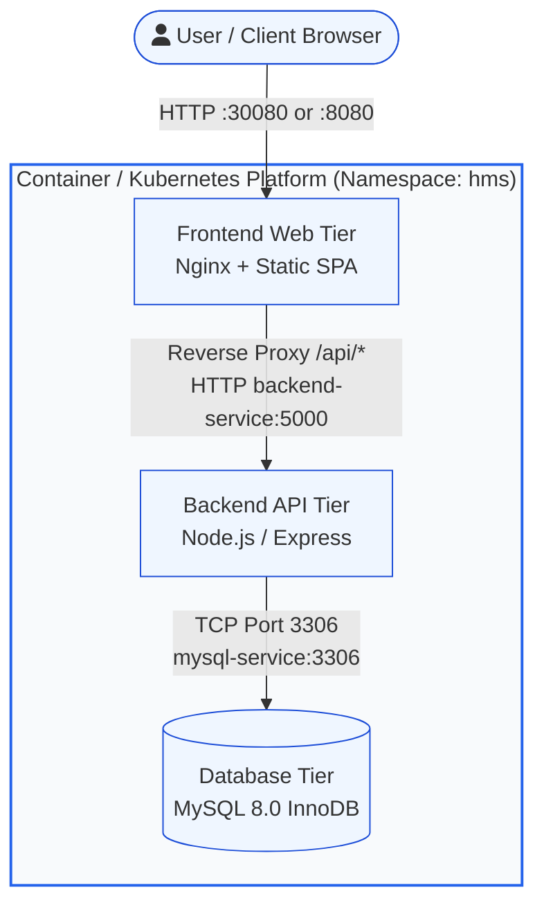

# Hospital Management System – DevOps Deployment

A production-style DevOps deployment repository for a full-stack Hospital Management System (HMS), showcasing containerization, container orchestration, configuration management, and declarative automated deployment.

---

## 1. Project Overview

The **Hospital Management System** provides an operational portal for hospital staff to manage patient registries, doctor assignments, and patient appointments. This repository automates the packaging, testing, and deployment of the three-tier application across local Docker environments, raw Kubernetes manifests, package-managed Helm charts, and automated Ansible playbooks.

---

## 2. Architecture & Networking

The system is designed as a three-tier architecture:



### Networking & Service Discovery
* **Client to Frontend**: Traffic reaches the Frontend via NodePort (`:30080` in Kubernetes) or mapped host port (`:8080` in Docker Compose).
* **Frontend to Backend**: Nginx reverse-proxies `/api/` calls directly to the internal Kubernetes Service `backend-service:5000`. Kubernetes CoreDNS resolves `backend-service` to the stable ClusterIP address assigned to backend pods.
* **Backend to MySQL**: The backend connects to MySQL via connection pool at host `mysql-service:3306`. CoreDNS resolves `mysql-service` to the MySQL ClusterIP.
* **Isolation**: All intra-service communication remains strictly private inside the Kubernetes virtual cluster network.

---

## 3. Technologies Used

* **Linux**: Alpine Linux container runtimes and POSIX-compliant scripting.
* **Docker**: Multi-stage builds, non-root container users, and container health checks.
* **Docker Compose**: Local multi-container development and smoke-testing workflow.
* **Kubernetes**: Declarative Deployments, ClusterIP & NodePort Services, ConfigMaps, and Secrets.
* **Helm**: Reusable and parameterized charts with centralized `values.yaml`.
* **Ansible**: Infrastructure automation playbook verifying CLI dependencies and orchestrating Helm deployments.
* **MySQL 8.0**: Relational database with automatic schema migration and seed data.
* **Git**: Version control with strict `.gitignore` rules preventing secret leaks.

---

## 4. Project Structure

```text
hospital-management-devops/
│
├── frontend/                     # Nginx-based multi-stage frontend
│   ├── src/                      # UI components, styles, and logic
│   ├── nginx.conf.template       # Environment-aware reverse proxy template
│   ├── Dockerfile                # Multi-stage build (Node build -> Nginx Alpine)
│   ├── .dockerignore
│   └── package.json
│
├── backend/                      # REST API backend
│   ├── server.js                 # Express server with MySQL connection pooling & auto-migration
│   ├── Dockerfile                # Lean Alpine image running as non-root
│   ├── .dockerignore
│   └── package.json
│
├── k8s/                          # Raw Kubernetes manifests
│   ├── 00-namespace.yaml         # Dedicated 'hms' namespace
│   ├── 01-secret.yaml            # Database credentials secret
│   ├── 02-configmap.yaml         # Non-sensitive service configuration
│   ├── 03-mysql.yaml             # MySQL Deployment and ClusterIP Service
│   ├── 04-backend.yaml           # Backend API Deployment and Service
│   └── 05-frontend.yaml          # Frontend Web Deployment and NodePort Service
│
├── helm/
│   └── hms/                      # Production Helm chart
│       ├── Chart.yaml            # Chart metadata
│       ├── values.yaml           # Centralized configuration values
│       └── templates/            # Parameterized Kubernetes templates
│           ├── _helpers.tpl
│           ├── secret.yaml
│           ├── configmap.yaml
│           ├── mysql-deployment.yaml
│           ├── mysql-service.yaml
│           ├── backend-deployment.yaml
│           ├── backend-service.yaml
│           ├── frontend-deployment.yaml
│           └── frontend-service.yaml
│
├── ansible/
│   └── deploy.yml                # Automated deployment & rollout playbook
│
├── docker-compose.yml            # Local developer testing stack
├── .env.example                  # Template configuration file
├── .gitignore                    # Sensitive file and artifact exclusions
└── README.md
```

---

## 5. Prerequisites

Before deployment, ensure the following utilities are installed:
* [Docker](https://docs.docker.com/get-docker/) & Docker Compose
* [kubectl](https://kubernetes.io/docs/tasks/tools/)
* [Helm](https://helm.sh/docs/intro/install/) (v3+)
* [Ansible](https://docs.ansible.com/ansible/latest/installation_guide/intro_installation.html) (optional for playbook execution)
* A running Kubernetes cluster (e.g., Minikube, Kind, k3s, EKS, or GKE)

---

## 6. Local Testing with Docker Compose

Verify application functionality locally before deploying to Kubernetes:

```bash
# 1. Start all services in detached mode
docker compose up -d --build

# 2. Inspect container status and health
docker compose ps

# 3. View live logs from all containers
docker compose logs -f

# 4. Access the application:
#    Frontend: http://localhost:8080
#    Backend Health Check: http://localhost:5000/health

# 5. Stop and clean up containers
docker compose down -v
```

---

## 7. Kubernetes Deployment (Raw Manifests)

Deploy the entire stack in logical order using the manifests in `k8s/`:

```bash
# 1. Apply namespace, secret, and configmap
kubectl apply -f k8s/00-namespace.yaml
kubectl apply -f k8s/01-secret.yaml
kubectl apply -f k8s/02-configmap.yaml

# 2. Deploy database tier
kubectl apply -f k8s/03-mysql.yaml

# 3. Deploy application backend and frontend
kubectl apply -f k8s/04-backend.yaml
kubectl apply -f k8s/05-frontend.yaml

# 4. Monitor deployment status
kubectl get pods,svc -n hms -o wide

# 5. Access frontend (if on Minikube / local cluster):
#    minikube service frontend-service -n hms
#    Or browse to http://<node-ip>:30080
```

---

## 8. Helm Deployment

Deploy or upgrade the system using the unified Helm chart:

```bash
# 1. Lint the Helm chart
helm lint helm/hms

# 2. Perform a dry-run test
helm install hms ./helm/hms --namespace hms --create-namespace --dry-run

# 3. Install or upgrade the chart
helm upgrade --install hms ./helm/hms --namespace hms --create-namespace

# 4. Check release status
helm status hms -n hms

# 5. Uninstall release when needed
helm uninstall hms -n hms
```

---

## 9. Automated Ansible Deployment

Run the Ansible playbook to automate tool verification, Helm deployment, rollout checks, and verification:

```bash
ansible-playbook ansible/deploy.yml
```

---

## 10. Deployment Troubleshooting Guide

When debugging Kubernetes or Docker workloads, execute these diagnosis commands:

### Kubernetes Diagnostics
```bash
# View pod states and restart counts
kubectl get pods -n hms

# Inspect pod events, scheduling decisions, and termination causes
kubectl describe pod <pod-name> -n hms

# View real-time container stdout/stderr
kubectl logs -f <pod-name> -n hms

# View logs of a crashed or restarted container
kubectl logs <pod-name> -n hms --previous

# Check cluster events sorted by creation time
kubectl get events -n hms --sort-by='.metadata.creationTimestamp'

# Check service endpoint mappings
kubectl get endpoints -n hms

# Test in-cluster network connectivity
kubectl run test-curl --rm -i --tty --image=curlimages/curl -n hms -- sh
# Inside pod:
# curl http://backend-service:5000/health
```

### Docker Diagnostics
```bash
# List all running and stopped containers
docker ps -a

# Check container resource utilization
docker stats

# Inspect container environment and network bindings
docker inspect <container-id>

# Follow container logs
docker logs --tail 100 -f <container-id>
```

---

## 11. Security Best Practices

* **No Plaintext Passwords Committed**: Database credentials are kept in `.env` (gitignored) and Kubernetes Secrets.
* **Least Privilege**: Backend container executes under the unprivileged `node` user (UID 1000).
* **Minimal Attack Surface**: Multi-stage builds and Alpine base images eliminate build tooling from production containers.
* **Liveness & Readiness Probes**: Faulty containers are quarantined from traffic until database connections are established.

---

## 12. Future Improvements

* Add Ingress resource with TLS termination (Let's Encrypt / cert-manager).
* Implement PersistentVolumeClaims with storage classes for high-availability database persistence.
* Implement CI/CD pipeline via GitHub Actions for automated Docker builds, vulnerability scanning (Trivy), and Helm publishing.
